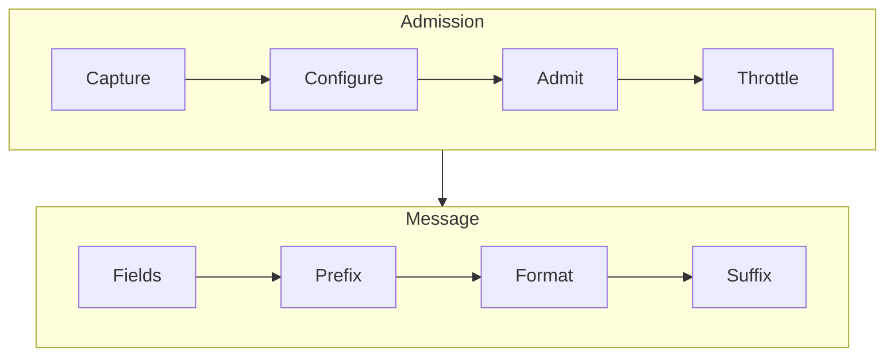

<!--
SPDX-FileCopyrightText: 2026 The ng-log contributors

SPDX-License-Identifier: BSD-3-Clause
-->

# Experimental Logging API

!!! warning "Experimental"
    API and ABI may change or be removed in any release without notice.

The experimental logging functions format messages with
[`std::format`](https://en.cppreference.com/w/cpp/utility/format/format) and
capture the call site with
[`std::source_location`](https://en.cppreference.com/w/cpp/utility/source_location).
They share the implementation of the [logging macros](index.md), so their
output is identical.

!!! info "Planned replacement of the macros"
    The functions are planned to supersede the macros in ng-log 0.10.0, after
    which the macros would be deprecated and eventually removed. Nothing is
    deprecated yet and the plan may change. See
    [Migrating from the Macros](#migrating-from-the-macros).

## Requirements

The functions require C++20 or newer with compile-time checked `std::format`
strings, `std::source_location` and `constexpr` [`std::string`](https://en.cppreference.com/w/cpp/string/basic_string) and are built whenever the compiler provides them.
The rest of the library requires C++14 only. If a requirement is missing, the
header fails with a single diagnostic that names it. Configuring with
`-DWITH_EXPERIMENTAL=OFF` omits the functions even if the compiler supports
them and does not install their headers. The headers in a build tree, such as
with `add_subdirectory`, then fail to compile with a diagnostic that says so.

The functions are opt-in. Include the umbrella header or only the headers
needed and compile the using translation units as C++20 or newer:

```cpp title="Including the functions"
#include <ng-log/experimental/logging.h>

namespace ngx = nglog::experimental;
```

| Header | Contents |
|--------|----------|
| `ng-log/experimental/logging.h` | All of the headers below, `ng-log/log_setup.h` and `ng-log/log_sink.h` |
| `ng-log/experimental/attributes.h` | [Attributes](#attributes) and [custom attributes](#custom-attributes) |
| `ng-log/experimental/format.h` | The format string and [`Lazy`](#lazy-arguments) |
| `ng-log/experimental/log_call.h` | `Log`, which the next two headers enable for their destinations, and `IsDebugEnabled` |
| `ng-log/experimental/log.h` | The regular destinations of `Log` and `Ensure`, and `IsEnabled` |
| `ng-log/experimental/signal_safe_log.h` | The [`SignalSafe`](#signal-safe-logging) destination of `Log` and `Ensure` |
| `ng-log/experimental/ensure.h` | `Ensure`, [comparisons](#comparisons), `That`, `NGLOG_COMPARE` and `NotNull` |
| `ng-log/experimental/sink.h` | [Structured sinks](#structured-sinks) |

`log.h`, `signal_safe_log.h` and `ensure.h` include `log_call.h`,
`attributes.h` and `format.h`. `Log` and `Ensure` write to the regular
destinations only if `log.h` is included and to the signal-safe one only if
`signal_safe_log.h` is. The examples below include the headers they use.

None of these headers defines unprefixed macros such as `LOG`, `CHECK` or
`VLOG`. A translation unit can therefore use the functions together with
another logging library that defines the same names, such as
[Abseil Logging](https://abseil.io/docs/cpp/guides/logging), as long as it does
not include the headers of the macros, `ng-log/logging.h`,
`ng-log/raw_logging.h` and `ng-log/vlog_is_on.h`.

The `experimental` component of the CMake package provides the
`ng-log::experimental` target, which links ng-log and compiles its consumers as
C++20 or newer. The component is available if ng-log was built with the
functions and the compiler of the consuming project supports them as well,
which `find_package` checks. Requiring the component otherwise fails with the
reason. Without components or with the component requested as optional, the
target is provided whenever the component is available, and
`ng-log_experimental_FOUND` tells whether it is:

```cmake title="Linking the functions in CMake"
find_package (ng-log 0.9.0 REQUIRED COMPONENTS experimental)

target_link_libraries (myapp PRIVATE ng-log::experimental)
```

If ng-log is added using `add_subdirectory`, the target exists only if the
functions were built, which `if (TARGET ng-log::experimental)` determines.

## Functions

`Log(attributes, format, args...)`

:   Logs a message described by [attributes](#attributes).

`Log{attributes, format, args...}`

:   Same as above, but evaluates the attributes before the arguments, except
    with MSVC. See [argument evaluation order](#argument-evaluation-order).

`Log(attributes)(format, args...)`

:   Two-stage form of the above, which also evaluates the attributes before
    the arguments.

`Log(format, args...)`

:   Logs an `Info` message.

`Log(condition, [attributes,] format, args...)`

:   Logs only if the condition holds, like `LOG_IF`. The condition must be a
    `bool`, so pointers and integers need an explicit comparison. Prefer an
    `if` statement, which also skips evaluating the arguments. See
    [conditions](#conditions).

`Ensure(condition, [attributes,] format, args...)`

:   Terminates with `Check failed: ` followed by the message unless the
    condition holds. Accepts all attributes except a severity.

`Ensure(comparison, [attributes,] [format, args...])`

:   Terminates with the description of a failed [comparison](#comparisons)
    or `NotNull` check followed by the message, which is optional since the
    description identifies the failure. Returns the operand of `That` or
    `NotNull`.

`IsEnabled(attributes)`

:   Returns whether the attributes admit a message at the call site. Runs only
    the `Configure` and `Admit` hooks and ignores the minimum log level and
    stripping. Rejects rate limits at compile time, since evaluating them
    would count an occurrence.

`IsDebugEnabled()`

:   Returns at compile time whether debug mode is on in the calling
    translation unit like `DCHECK_IS_ON()`, such as to skip expensive code with
    `if constexpr`.

Format strings are checked at compile time:

```cpp title="Logging and checking"
#include <ng-log/experimental/log.h>
#include <ng-log/experimental/ensure.h>

ngx::Log("Found {} cookies", num_cookies);
ngx::Log(ngx::Warning, "Disk {} is {}% full", name, usage);
ngx::Ensure(fd >= 0, ngx::Errno, "fd >= 0 Cannot open {}", path);
```

!!! warning "Argument evaluation order"
    An argument such as `f()` may change `errno` before `Errno` captures it,
    since C++ leaves the evaluation order of arguments unspecified. The
    two-stage form `ngx::Log(attributes)(format, args...)` captures it first.
    `Ensure` has no such form. See
    [argument evaluation order](#argument-evaluation-order).

### Conditions

Log conditionally with an `if` statement, which skips the arguments as well:

```cpp title="Logging conditionally"
#include <ng-log/experimental/log.h>

if (retries > kMaxRetries) {
  ngx::Log(ngx::Warning, "Giving up after {}", Describe(attempts));
}
```

A condition passed to `Log` logs the same message but evaluates the arguments
regardless, so `Describe(attempts)` runs even if the condition does not hold:

```cpp title="Logging with a condition argument"
#include <ng-log/experimental/log.h>

ngx::Log(retries > kMaxRetries, ngx::Warning, "Giving up after {}",
         Describe(attempts));
```

A check cannot do without its condition. As with any function call, the
arguments of `Ensure` are evaluated even if the check passes. Defer expensive
arguments of both with [`Lazy`](#lazy-arguments).

### Comparisons

Comparisons describe the failure like the `CHECK_EQ` family, including both
operands. `That` wraps the left operand of a comparison using `==`, `!=`, `<`,
`<=`, `>` or `>=` and covers every comparison of the macros:

```cpp title="Checking comparisons"
#include <ng-log/experimental/ensure.h>
#include <ng-log/experimental/log.h>

ngx::Ensure(ngx::That(a) == b, "msg {}", x);
// Check failed: lhs == rhs (1 vs. 2) msg 3

ngx::Ensure(ngx::That(s1) == s2);
// CHECK_STREQ failed: lhs == rhs (abc vs. abd)

ngx::Ensure(ngx::That(s1).IgnoreCase() != s2);
// CHECK_STRCASENE failed: lhs != rhs (abc vs. ABC)

ngx::Ensure(NGLOG_COMPARE(a == b), "msg {}", x);
// Check failed: a == b (1 vs. 2) msg 3
```

Since a function cannot capture the expression, a failure of `That` names the
operator but not the operands. The log line names the file and line of the
check instead. The left operand may contain any operator, such as
`ngx::That(a + b * 2) == c` or `ngx::That(x > 0 && y > 0) == true`. A right
operand containing an operator that binds weaker than comparisons, such as
`&&` or `?:`, must be parenthesized. Otherwise the check is rejected at compile
time, as is `That` without a comparison.

Unlike `CHECK_EQ`, `That` compares C strings, `char` pointers and arrays, by
their contents like `CHECK_STREQ`. `AsPointer` compares any pointer by
address instead, such as `ngx::That(s).AsPointer() == t`, and prints both
addresses on failure. `IgnoreCase` compares C strings ignoring case
like `CHECK_STRCASEEQ`. C strings cannot be ordered, and C strings of other
character types such as `wchar_t` cannot be compared, since comparing their
addresses is rarely intended. Both are rejected at compile time in favor of
[`std::basic_string_view`](https://en.cppreference.com/w/cpp/string/basic_string_view) operands.

`Near` checks like `CHECK_NEAR` that the operand lies within a margin of a
value, and without a margin like `CHECK_DOUBLE_EQ`. Unlike the macros, which
expand to two checks, it evaluates each operand once and reports both bounds:

```cpp title="Checking ranges"
#include <ng-log/experimental/ensure.h>
#include <ng-log/experimental/log.h>

ngx::Ensure(ngx::That(x).Near(y, 0.1));
// Check failed: lhs near rhs (1.5 vs. 1 +/- 0.1)

ngx::Ensure(ngx::That(i).IndexOf(a));
// Check failed: lhs index of rhs (5 vs. size 3)

ngx::Ensure(ngx::That(x).InRange(0.0, 1.0));
// Check failed: lhs in range (1.5 vs. [0, 1))
```

`IndexOf` checks like `CHECK_INDEX` that an integer is a valid index of an
array, a container or any other range whose size is known. `BoundOf` also
admits the size like `CHECK_BOUND`, such as for the end of a subrange. A
negative integer fails both. `InRange` checks the half-open range
`[low, high)` of any ordered values. Integers compare by value regardless of
their signedness.

Comparing a raw, member or smart pointer with `nullptr` using `!=` checks like
`CHECK_NOTNULL`. Like `CHECK_NOTNULL`, `Ensure` returns the operand of any
comparison created by `That`, an lvalue by reference and an rvalue by value,
so the check can initialize members. `That` holds a reference to an lvalue and
takes ownership of an rvalue, so a stored operand must not outlive what an
lvalue operand refers to. The comparison moves the operand into its result, so
a stored operand is compared by moving it. A bit-field cannot be referenced, so
it is passed as a value, such as `ngx::That(+flags.ready) == 1`:

```cpp title="Checking operands in an initializer"
#include <ng-log/experimental/ensure.h>
#include <ng-log/experimental/log.h>

Widget::Widget(std::unique_ptr<Engine> engine, std::string name)
    : engine_{ngx::Ensure(ngx::That(std::move(engine)) != nullptr)},
      name_{ngx::Ensure(ngx::That(std::move(name)) != "")} {}
// Check failed: lhs != rhs (0 vs. nullptr)
```

`NGLOG_COMPARE` captures the text of the expression instead, so the failure
names the operands exactly like `CHECK_EQ`. Use it if the message must identify
the operands or match the output of the macros, such as while migrating.
`NGLOG_COMPARE(a == b)` is equivalent to `ngx::Eq(a, b, "a == b")`. The left
operand may contain arithmetic, such as `NGLOG_COMPARE(a + b * 2 == c)`.
Shifts in the left operand and operators that bind weaker than comparisons in
either operand, such as `&&`, `||`, `&` and `?:`, must be parenthesized.
Otherwise the expression is rejected at compile time, as is one without a
comparison or with a comma. Three-way comparisons cannot be checked, since
their result compares only with a literal zero, so check `std::is_lt(a <=> b)`
and its siblings as a condition instead. Like `CHECK_EQ`, `==` compares C
strings by address.

The macros map to `That` and to functions that, like the macros, take the
text to print:

| Comparison | Macro equivalent |
|------------|------------------|
| `That(a) == b` and the other operators, `NGLOG_COMPARE(a == b)` | `CHECK_EQ(a, b)` and its siblings |
| `That(s1) == s2`, `That(s1) != s2` | `CHECK_STREQ`, `CHECK_STRNE` |
| `That(s1).IgnoreCase() == s2`, `That(s1).IgnoreCase() != s2` | `CHECK_STRCASEEQ`, `CHECK_STRCASENE` |
| `That(p) != nullptr` | `CHECK_NOTNULL` |
| `That(x).Near(y, m)`, `That(x).Near(y)` | `CHECK_NEAR`, `CHECK_DOUBLE_EQ` |
| `That(i).IndexOf(a)`, `That(b).BoundOf(a)` | `CHECK_INDEX`, `CHECK_BOUND` |
| `Eq`, `Ne`, `Lt`, `Le`, `Gt`, `Ge` | `CHECK_EQ`, `CHECK_NE`, `CHECK_LT`, `CHECK_LE`, `CHECK_GT`, `CHECK_GE` |
| `StrEq`, `StrNe` | `CHECK_STREQ`, `CHECK_STRNE` |
| `StrCaseEq`, `StrCaseNe` | `CHECK_STRCASEEQ`, `CHECK_STRCASENE` |
| `NotNull` | `CHECK_NOTNULL` |

Operands are rendered like the macros render them if both support `<<` and
with `std::format` otherwise. Unlike the macros, integers of mixed signedness
compare by value, so `Lt(-1, 1u, "-1 < 1u")` holds. String comparisons take C
strings. Like the macros, null equals only null and prints as empty.

`NotNull` accepts raw, member and smart pointers. Wrappers such as
[`std::optional`](https://en.cppreference.com/w/cpp/utility/optional) are rejected, since an empty one compares unequal to `nullptr`.
Unlike `CHECK_NOTNULL`, `NotNull` also rejects function wrappers such as
`std::function`, which are no pointers. Check them as a condition instead, such
as `ngx::Ensure(static_cast<bool>(callback), "callback")`.
`ngx::Ensure(ngx::NotNull(std::move(engine), "engine"))` fails with
`Check failed: 'engine' Must be non nullptr`.

### Constant Evaluation

All functions except `IsEnabled` can be called in `constexpr` functions.
During constant evaluation, logging has no effect and a failed check is a
compile error that names `EnsureFailedDuringConstantEvaluation`:

```cpp title="Checking during constant evaluation"
#include <ng-log/experimental/ensure.h>
#include <ng-log/experimental/log.h>

constexpr int Divide(int a, int b) {
  ngx::Ensure(ngx::Ne(b, 0, "b != 0"));
  return a / b;
}

static_assert(Divide(6, 3) == 2, "Divide must work in constant expressions");
constexpr int kInvalid = Divide(1, 0);  // does not compile
```

Checks with `Debug` are skipped if debug mode is off. During constant
evaluation, comparisons describe a failure by the expression text only, and
case-insensitive string comparisons consider ASCII letters only.

### Signal-Safe Logging

With the `SignalSafe` attribute, `Log` and `Ensure` are designed for signal
handlers and low-level code. Like `RAW_LOG`, whose format and implementation
they share, they write to stderr and neither allocate nor acquire locks, with
the exceptions described below. A failed signal-safe check writes
`Check failed: ` before the message:

```cpp title="Logging without allocating"
#include <ng-log/experimental/ensure.h>
#include <ng-log/experimental/signal_safe_log.h>

ngx::Log(ngx::SignalSafe | ngx::Error, "read failed with {} on fd {}", result,
         fd);
// E00000000 00:00:00.000000  1234 file.cc:42] RAW: read failed with -1 on fd 3

ngx::Ensure(fd >= 0, ngx::SignalSafe, "bad fd {}", fd);
// F00000000 00:00:00.000000  1234 file.cc:45] RAW: Check failed: bad fd -1
```

To guarantee that formatting neither allocates nor locks, `SignalSafe` rejects
at compile time:

- arguments other than integers, floating-point numbers, characters, `bool`,
  `void` pointers, `nullptr`, C strings, [`std::string_view`](https://en.cppreference.com/w/cpp/string/basic_string_view) and `std::string`
- the locale-specific option `L`
- attributes other than a severity, `Debug` and `Verbose`, including the other
  destinations
- comparisons and `NotNull` in `Ensure`, whose descriptions allocate

Like `RAW_VLOG`, `Verbose` allocates and acquires a lock on the first call of
a call site. Call sites that do not fit a lookup table of 4096 locations
acquire a lock on every call.

With iterator debugging of the Microsoft C++ standard library, which debug
builds enable by default, `std::format` allocates once for each integer with a
format specification, such as `{:#x}`, and for each character or `bool` with
an integer presentation type. Release builds do not allocate.

Floating-point arguments are formatted using [`std::to_chars`](https://en.cppreference.com/w/cpp/utility/to_chars), which never
allocates, with the same output as `std::format`. With libstdc++, `std::to_chars`
formats a `long double` with a precision or an `e` or `g` type using
`sprintf`, which, like the prefix of `RAW_LOG`, is not async-signal-safe. Like
its `std::format`, libc++ formats a `long double` as a `double`, so values
beyond the range or the precision of `double` lose them. Their specification may
contain an ASCII fill, alignment, sign, zero padding and a width of at most
512. The precision is limited to 64 and the type to `a`, `e`, `f`, `g` and
their uppercase variants. Dynamic widths and precisions, the alternate form
`#` and the fixed notation of `long double`, which can exceed the buffer, are
rejected at compile time:

```cpp title="Formatting floating-point numbers"
#include <ng-log/experimental/signal_safe_log.h>

ngx::Log(ngx::SignalSafe, "{:.3f} {:+e}", 3.14159, 1e300);  // compiles
ngx::Log(ngx::SignalSafe, "{:.65f}", 1.0);  // rejected: precision above 64
ngx::Log(ngx::SignalSafe, "{:f}", 1.0L);    // rejected: long double fixed
```

A format error detected at runtime, such as a negative dynamic width of an
integer argument, throws [`std::format_error`](https://en.cppreference.com/w/cpp/utility/format/format_error), which allocates.

### Lazy Arguments

Arguments are evaluated before the call even if the message is not logged.
`Lazy` defers an expensive argument to a callable that runs only if the
message is formatted, once for each replacement field that refers to it. Its
result is formatted with the specification of the replacement field:

```cpp title="Deferring an expensive argument"
#include <ng-log/experimental/log.h>

ngx::Log(ngx::Verbose{2}, "state: {:>20}",
         ngx::Lazy([&] { return Dump(state); }));
```

`SignalSafe` does not accept lazy arguments, since the callable may allocate.

### Types Without a Formatter

The functions format the arguments of a message using `std::format` only. A
type that supports `operator<<` but no formatter is logged by providing a
[`std::formatter`](https://en.cppreference.com/w/cpp/utility/format/formatter)
specialization for it:

```cpp title="Formatting a custom type"
#include <format>

#include <ng-log/experimental/log.h>

struct Point {
  int x;
  int y;
};

template <>
struct std::formatter<Point> {
  constexpr auto parse(std::format_parse_context& context) {
    return context.begin();
  }

  auto format(const Point& point, std::format_context& context) const {
    return std::format_to(context.out(), "({}, {})", point.x, point.y);
  }
};

ngx::Log("Moved to {}", Point{1, 2});
```

### Querying the Verbosity

`IsEnabled(Verbose{n})` corresponds to `VLOG_IS_ON(n)`, which remains
available. It honors `--v` and `--vmodule` with every compiler and preserves
`errno`.

Attributes are literal types. Define them once as `constexpr` to use the same
attributes for the query and the message:

```cpp title="Querying the verbosity before logging"
#include <ng-log/experimental/log.h>

constexpr auto kStatistics = ngx::Verbose{2} | ngx::Tag{"stats"};

if (ngx::IsEnabled(kStatistics)) {
  ngx::Log(kStatistics, "Statistics: {}", ComputeStatistics());
}
```

## Attributes

Attributes are composed with `|` and apply in order:

```cpp title="Composing attributes"
#include <ng-log/experimental/log.h>

ngx::Log(ngx::Error | ngx::Errno | ngx::Tag{"net"}, "Cannot connect to {}",
         host);
ngx::Log(ngx::Verbose{2} | ngx::Every{100}, "Processed {} items", count);
```

`|` requires at least one operand provided by ng-log. `ngx::Attributes{...}`
composes custom attributes only:

```cpp title="Composing custom attributes"
#include <ng-log/experimental/log.h>

ngx::Log(ngx::Attributes{Component{"db"}, Once{}}, "Query took {}", t);
```

An attribute appears at most once unless it is multiple, such as `ToSink`, which
sends the message to each of several sinks. Distinct attributes of the same
category, such as `Syslog` and `ToString`, exclude each other. Compositions
that violate either rule, such as `ngx::Info | ngx::Warning`, do not compile,
and the diagnostic names the concept of the rule, `SingleAttributesAreUnique`
or `CategoriesAreDistinct`. In the following table, `?` means at most once and
`*` any number of times:

| Attributes | Category | Multiplicity |
|------------|----------|--------------|
| `Info`, `Warning`, `Error`, `Fatal`, `Severity{s}` | Severity | `?` |
| `Every`, `First` | Rate limit | `?` |
| `Syslog`, `SignalSafe` | Destination | `?` |
| `ToSink`, `ToString`, `ToVector` | Destination | `*` |
| `Tag`, `Errno`, `Debug`, `Verbose`, `FatalInDebug`, `SkipLogFile` | Own | `?` |
| Custom attributes | `Category`, if declared | `?`, or `*` if `Multiple` |

A message therefore has, for instance, a single severity and a destination of
one kind, which is either `Syslog` or any number of sinks, strings or vectors.
`SkipLogFile` requires at least one sink. `Ensure` accepts no severity.

### Provided Attributes

#### Severity

| Attribute | Effect | Macro equivalent |
|-----------|--------|------------------|
| `Info`, `Warning`, `Error`, `Fatal` | Logs at the severity. The default is `Info`. | `LOG(severity)` |
| `FatalInDebug` | Raises the severity to `Fatal` in debug mode. | none |
| `Severity{s}` | Logs at a runtime severity. | `LOG_AT_LEVEL(s)` |

`Error | FatalInDebug` behaves like `LOG(DFATAL)` in either order. Debug mode,
which `FatalInDebug` depends on, and `NGLOG_STRIP_LOG` follow the
configuration of the calling translation unit. See
[stripping](../log_stripping.md). Unlike `LOG_EVERY_N`, `LOG_FIRST_N`,
`LOG_AT_LEVEL` and `SYSLOG`, which `NGLOG_STRIP_LOG` does not strip, every
message is stripped below the configured level regardless of its attributes.

Unlike `LOG_AT_LEVEL`, `Severity{s}` ensures that `s` is one of the four
severities. Another value fails to compile during constant evaluation and
terminates like a failed check otherwise.

#### Tag

| Attribute | Effect | Macro equivalent |
|-----------|--------|------------------|
| `Tag{"name"}` | Sets the tag for system loggers that support tags. | none |

On Android, messages written to logcat are tagged with the short program name.
`Tag` overrides it per message:

```cpp title="Tagging a message"
#include <ng-log/experimental/log.h>

ngx::Log(ngx::Warning | ngx::Tag{"network"}, "Connection lost");
```

The tag must stay valid until the call returns. Other platforms ignore it.

#### Errno

| Attribute | Effect | Macro equivalent |
|-----------|--------|------------------|
| `Errno` | Appends `: <description> [<errno>]`. Captures `errno` before the arguments in the [braced and two-stage forms](#argument-evaluation-order). | `PLOG(severity)` |

#### Debug

| Attribute | Effect | Macro equivalent |
|-----------|--------|------------------|
| `Debug` | Logs in debug mode only. | `DLOG(severity)` |

Debug mode follows the calling translation unit and is on unless `NDEBUG` is
defined without `DCHECK_ALWAYS_ON`.

Unlike `DLOG` and `DCHECK`, whose operands disappear with the macro, the
arguments of a function are evaluated in either mode. Outside debug mode, a
message with `Debug` is neither formatted nor logged, but its arguments, the
condition of `Ensure` and the operands of a comparison, which describes its
failure, are still evaluated. Pass expensive arguments as
[`Lazy`](#lazy-arguments), or skip expensive checks with
`if constexpr (ngx::IsDebugEnabled())`.

#### Verbosity

| Attribute | Effect | Macro equivalent |
|-----------|--------|------------------|
| `Verbose{n}` | Logs if the verbosity of the call site is at least `n`. | `VLOG(n)` |

`Verbose` derives the `--vmodule` module from the file name like `VLOG`. The
level may have any standard integer type, deduced from the argument. Levels
outside the range of `--v` saturate instead of wrapping around.

#### Rate Limit

| Attribute | Effect | Macro equivalent |
|-----------|--------|------------------|
| `Every{n}` | Logs the first and every `n`-th occurrence. | `LOG_EVERY_N(severity, n)` |
| `First{n}` | Logs the first `n` occurrences. | `LOG_FIRST_N(severity, n)` |
| `Every{duration}` | Logs at most once per duration. | `LOG_EVERY_T(severity, seconds)` |

The argument of `Every` selects how it limits the rate: an integer counts
occurrences and a duration limits the time between messages. The counter type
of `Every` and `First` is deduced from `n`. Any standard integer type is
accepted:

```cpp title="Choosing the counter type"
#include <ng-log/experimental/log.h>

ngx::Log(ngx::Every{1000}, "msg");               // counts using int
ngx::Log(ngx::Every{std::size_t{1000}}, "msg");  // counts using std::size_t
```

Counting never overflows, even if `n` is the maximum of the counter type. The
occurrence count below wraps around at the limit of the type instead.

A period is a [`std::chrono` duration](https://en.cppreference.com/w/cpp/chrono/duration) of any representation. A number
without a unit, such as a `double` of seconds, does not compile, since it is
neither a count nor a period:

```cpp title="Rate limiting by time"
#include <ng-log/experimental/log.h>

using namespace std::chrono_literals;

ngx::Log(ngx::Every{500ms}, "msg");
ngx::Log(ngx::Every{0.5s}, "msg");
ngx::Log(ngx::Every{0.5}, "msg");  // does not compile
```

Durations beyond the range of [`std::chrono::nanoseconds`](https://en.cppreference.com/w/cpp/chrono/duration) saturate. Like
`LOG_EVERY_T`, the first message is logged only once the [steady clock](https://en.cppreference.com/w/cpp/chrono/steady_clock) exceeds
the duration since its epoch.

The `Occurrence` argument formats how often the call site occurred, like
`LOG_OCCURRENCES` and `nglog::COUNTER`, in the counter type of `Every` or
`First` counting occurrences. Like `LOG_EVERY_N`, `Every` counts the
occurrences and decides which to log separately, so messages logged
concurrently can report counts other than those of the occurrences logged. A
period does not count occurrences, so using `Occurrence` without a count does
not compile:

```cpp title="Logging the occurrence count"
#include <ng-log/experimental/log.h>

ngx::Log(ngx::Every{100}, "Got the {}th cookie", ngx::Occurrence);
```

#### Destination

| Attribute | Effect | Macro equivalent |
|-----------|--------|------------------|
| `Syslog` | Also logs to syslog. | `SYSLOG(severity)` |
| `ToSink{&sink}` | Also logs to a sink or a [structured sink](#structured-sinks). Repeat it for several sinks. | `LOG_TO_SINK(&sink, severity)` |
| `SkipLogFile` | Logs to the sinks of `ToSink` only. Requires a sink. | `LOG_TO_SINK_BUT_NOT_TO_LOGFILE` with `ToSink` |
| `ToString{&text}` | Also stores the text in a string. Repeat it for several strings. | `LOG_TO_STRING(severity, &text)` |
| `ToVector{&texts}` | Appends the text to a vector instead of logging. Repeat it for several vectors. Null vectors are ignored, and the message is logged if all of them are null. | `LOG_STRING(severity, &texts)` |

### Argument Evaluation Order

C++ leaves the order in which the arguments of a function call are evaluated
unspecified. In `ngx::Log(ngx::Errno, "{}", f())`, `f()` may run and change
`errno` before `Errno` captures it, which GCC does on x86-64. Two forms enforce
the order:

- **Two-stage call:** `ngx::Log(attributes)(format, args...)`. The function is
  evaluated before its arguments, so the logger captures the state before the
  arguments of the second stage. The logger can only be called right away, and
  discarding it without calling it is diagnosed.
- **Braces:** `ngx::Log{attributes, format, args...}`. The elements of a braced
  initializer list are evaluated from left to right, so the attributes capture
  their state before any argument is evaluated.

!!! warning "MSVC"
    MSVC 19.51 does not evaluate braced constructor arguments from left to
    right, contrary to the standard. Use the two-stage form with MSVC.

```cpp title="Capturing errno before the arguments"
#include <ng-log/experimental/log.h>

// errno is captured before Describe(file) runs.
ngx::Log(ngx::Error | ngx::Errno)("Cannot open {}", Describe(file));
ngx::Log{ngx::Error | ngx::Errno, "Cannot open {}", Describe(file)};
```

Parentheses compile as well but do not enforce the order. Only attributes with
a [`Capture` hook](#custom-attributes), such as `Errno`, depend on it. `Ensure`
does not enforce the order. Since `Log` is a class template,
`ngx::Log(kFormat);` with a single identifier is parsed as a declaration and
does not compile. Use braces in that case.

### Migrating from the Macros

Conditions preferably become `if` statements, which also skip evaluating the
arguments. `ngx::Log(c, ngx::Error, "msg")` corresponds to `LOG_IF(ERROR, c)`
but evaluates the arguments regardless. Macro variants become attribute
combinations. The functions below are declared in `log.h`,
`signal_safe_log.h` and `ensure.h` of `ng-log/experimental`, the macros in
`ng-log/logging.h` and `ng-log/raw_logging.h`. Comparisons use `That`. Where a failure must read
exactly like the macro's, such as `a == b (1 vs. 2)`, use `NGLOG_COMPARE`
instead. The examples assume [`using namespace std::chrono_literals;`](https://en.cppreference.com/w/cpp/symbol_index/chrono_literals).

#### Severity

<div class="grid" markdown>

``` cpp title="Macros"
LOG(INFO) << "x=" << x;

LOG(DFATAL) << "msg";


LOG_AT_LEVEL(s) << "msg";
```

``` cpp title="Functions"
ngx::Log("x={}", x);

ngx::Log(ngx::Error |
             ngx::FatalInDebug,
         "msg");

ngx::Log(ngx::Severity{s}, "msg");
```

</div>

#### Conditions and Rate Limits

<div class="grid" markdown>

``` cpp title="Macros"
LOG_IF(ERROR, c) << "msg";


LOG_EVERY_N(INFO, 10) << "msg";

LOG_EVERY_N(INFO, 10)
    << "n=" << LOG_OCCURRENCES;

LOG_IF_EVERY_N(INFO, c, 10) << "msg";


LOG_FIRST_N(INFO, 10) << "msg";

LOG_EVERY_T(INFO, 0.5) << "msg";
```

``` cpp title="Functions"
if (c) {
  ngx::Log(ngx::Error, "msg");
}

ngx::Log(ngx::Every{10}, "msg");

ngx::Log(ngx::Every{10}, "n={}",
         ngx::Occurrence);

if (c) {
  ngx::Log(ngx::Every{10}, "msg");
}

ngx::Log(ngx::First{10}, "msg");

ngx::Log(ngx::Every{500ms}, "msg");
```

</div>

#### Debug

<div class="grid" markdown>

``` cpp title="Macros"
DLOG(WARNING) << "msg";


DLOG_IF(WARNING, c) << "msg";


DLOG_EVERY_N(INFO, 10) << "msg";


DLOG_FIRST_N(INFO, 10) << "msg";


DLOG_EVERY_T(INFO, 1) << "msg";


DLOG_IF_EVERY_N(INFO, c, 10) << "msg";


if (DCHECK_IS_ON()) {
  // ...
}
```

``` cpp title="Functions"
ngx::Log(ngx::Warning | ngx::Debug,
         "msg");

if (c) {
  ngx::Log(ngx::Warning | ngx::Debug,
           "msg");
}

ngx::Log(ngx::Debug | ngx::Every{10},
         "msg");

ngx::Log(ngx::Debug | ngx::First{10},
         "msg");

ngx::Log(ngx::Debug | ngx::Every{1s},
         "msg");

if (c) {
  ngx::Log(
      ngx::Debug | ngx::Every{10},
      "msg");
}

if constexpr (ngx::IsDebugEnabled()) {
  // ...
}
```

</div>

#### Verbosity

<div class="grid" markdown>

``` cpp title="Macros"
VLOG(2) << "msg";

VLOG_IF(2, c) << "msg";


VLOG_EVERY_N(2, 10) << "msg";


VLOG_IF_EVERY_N(2, c, 10) << "msg";


DVLOG(2) << "msg";


if (VLOG_IS_ON(2)) {
  // ...
}
```

``` cpp title="Functions"
ngx::Log(ngx::Verbose{2}, "msg");

if (c) {
  ngx::Log(ngx::Verbose{2}, "msg");
}

ngx::Log(ngx::Verbose{2} |
             ngx::Every{10},
         "msg");

if (c) {
  ngx::Log(ngx::Verbose{2} |
               ngx::Every{10},
           "msg");
}

ngx::Log(ngx::Verbose{2} | ngx::Debug,
         "msg");

if (ngx::IsEnabled(ngx::Verbose{2})) {
  // ...
}
```

</div>

#### Errno

<div class="grid" markdown>

``` cpp title="Macros"
PLOG(ERROR) << "open " << name;


PLOG_IF(ERROR, c) << "open";


PLOG_EVERY_N(ERROR, 10) << "open";
```

``` cpp title="Functions"
ngx::Log(ngx::Error |
         ngx::Errno)("open {}", name);

if (c) {
  ngx::Log(ngx::Error |
           ngx::Errno)("open");
}

ngx::Log(ngx::Error | ngx::Errno |
         ngx::Every{10})("open");
```

</div>

#### Destinations

<div class="grid" markdown>

``` cpp title="Macros"
SYSLOG(INFO) << "msg";

SYSLOG_IF(INFO, c) << "msg";


SYSLOG_EVERY_N(INFO, 10) << "msg";


LOG_TO_SINK(&sink, INFO) << "msg";

LOG_TO_SINK_BUT_NOT_TO_LOGFILE(&sink,
                               INFO)
    << "msg";

LOG_TO_STRING(INFO, &text) << "msg";

LOG_STRING(INFO, &texts) << "msg";
```

``` cpp title="Functions"
ngx::Log(ngx::Syslog, "msg");

if (c) {
  ngx::Log(ngx::Syslog, "msg");
}

ngx::Log(ngx::Syslog |
             ngx::Every{10},
         "msg");

ngx::Log(ngx::ToSink{&sink}, "msg");

ngx::Log(ngx::ToSink{&sink} |
             ngx::SkipLogFile,
         "msg");

ngx::Log(ngx::ToString{&text}, "msg");

ngx::Log(ngx::ToVector{&texts},
         "msg");
```

</div>

#### Signal-Safe Logging

A failed signal-safe check reports `Check failed: msg` instead of
`Check p failed: msg`.

<div class="grid" markdown>

``` cpp title="Macros"
RAW_LOG(WARNING, "fd %d", fd);


RAW_DLOG(INFO, "fd %d", fd);


RAW_VLOG(2, "fd %d", fd);


RAW_CHECK(p, "msg");


RAW_DCHECK(p, "msg");
```

``` cpp title="Functions"
ngx::Log(ngx::SignalSafe |
             ngx::Warning,
         "fd {}", fd);

ngx::Log(ngx::SignalSafe | ngx::Debug,
         "fd {}", fd);

ngx::Log(ngx::SignalSafe |
             ngx::Verbose{2},
         "fd {}", fd);

ngx::Ensure(p, ngx::SignalSafe,
            "msg");

ngx::Ensure(p,
            ngx::SignalSafe |
                ngx::Debug,
            "msg");
```

</div>

#### Checks and Assertions

The assertion macros log at the fatal severity like a failed check, so they map
to `Ensure`, whose message starts with `Check failed:` instead of
`Assert failed:`.

<div class="grid" markdown>

``` cpp title="Macros"
CHECK(p) << "msg";

PCHECK(p) << "msg";

DCHECK(p) << "msg";

CHECK_EQ(a, b) << "msg";

DCHECK_LT(i, n);


CHECK_STRCASEEQ(s1, s2);


CHECK_NEAR(x, y, m);

CHECK_DOUBLE_EQ(x, y);

CHECK_NOTNULL(p);

CHECK_INDEX(i, a);

CHECK_BOUND(b, a);

LOG_ASSERT(p);

DLOG_ASSERT(p);

SYSLOG_ASSERT(p);
```

``` cpp title="Functions"
ngx::Ensure(p, "p msg");

ngx::Ensure(p, ngx::Errno, "p msg");

ngx::Ensure(p, ngx::Debug, "p msg");

ngx::Ensure(ngx::That(a) == b, "msg");

ngx::Ensure(ngx::That(i) < n,
            ngx::Debug);

ngx::Ensure(
    ngx::That(s1).IgnoreCase() == s2);

ngx::Ensure(ngx::That(x).Near(y, m));

ngx::Ensure(ngx::That(x).Near(y));

ngx::Ensure(ngx::That(p) != nullptr);

ngx::Ensure(ngx::That(i).IndexOf(a));

ngx::Ensure(ngx::That(b).BoundOf(a));

ngx::Ensure(p, "p");

ngx::Ensure(p, ngx::Debug, "p");

ngx::Ensure(p, ngx::Syslog, "p");
```

</div>

## Custom Attributes

Any class type with at least one of the following `const` member functions is
an attribute:

`void Configure(nglog::experimental::Context&) const`

:   Sets the severity, tag or other settings.

`bool Admit(nglog::experimental::Context&) const`

:   Returns `false` to discard the message.

`bool Throttle(nglog::experimental::Context&) const`

:   Rate limits the message. Runs after all `Admit` hooks passed. Returns
    `false` to discard the message.

`void Prefix(nglog::experimental::Message&) const`

:   Appends text before the formatted message.

`void Suffix(nglog::experimental::Message&) const`

:   Appends text after the formatted message.

`void Fields(nglog::experimental::FieldWriter&) const`

:   Adds fields for [structured sinks](#structured-sinks). Runs only if one
    receives the message.

An attribute may additionally capture state at the call site:

`A Capture() const`

:   Returns a copy of the attribute `A` with captured state, such as `errno`.
    Runs before the arguments are evaluated in the [braced and two-stage
    forms](#argument-evaluation-order) of `Log`. Otherwise it runs in
    unspecified order relative to the arguments, and after them in `Ensure`.

Hooks run in phases, each in composition order:



A `false` from `Admit` or `Throttle` discards the message. Stripping is
checked after `Admit` and `--minloglevel` after `Throttle`, so rate limits
count suppressed messages like the macros do. Arguments are formatted only if
the message is logged. `IsEnabled` runs `Configure` and `Admit` only.

A member type `Category` makes distinct attributes of that category exclusive.
An attribute appears at most once in a composition unless it declares
`using Multiplicity = ngx::Multiple;`.

`Context` provides the severity, tag, debug mode and call site location. Its
setters change the severity, the tag and the `errno` the message reports. `site()`
returns per-site state, created on first use, alive until program exit and
shared across threads. `Message` appends text and provides the `errno` the
message reports. Its `out()` returns an output iterator, so
[`std::format_to(message.out(), ...)`](https://en.cppreference.com/w/cpp/utility/format/format_to) formats without a temporary string.

Examples that prepend a component, gate on a switch and log a site once:

```cpp title="Defining custom attributes"
#include <atomic>
#include <format>
#include <string_view>

#include <ng-log/experimental/attributes.h>
#include <ng-log/experimental/log.h>

struct Component {
  std::string_view name;

  void Prefix(ngx::Message& message) const {
    std::format_to(message.out(), "[{}] ", name);
  }
};

struct Switch {
  const std::atomic<bool>* on;

  bool Admit(ngx::Context&) const {
    return on->load(std::memory_order_relaxed);
  }
};

struct Once {
  struct State {
    std::atomic_flag logged;
  };

  bool Throttle(ngx::Context& context) const {
    return !context.site().state<State>().logged.test_and_set(
        std::memory_order_relaxed);
  }
};

ngx::Log(ngx::Warning | Component{"net"} | Once{}, "Retrying");
```

## Structured Sinks

A `nglog::LogSink` receives the formatted text only. A structured
`ngx::Sink` receives an `ngx::Record`, which also provides the location of the
call including the function, the tag, the time as
[`std::chrono::sys_time`](https://en.cppreference.com/w/cpp/chrono/system_clock)
with the UTC offset of the log files, and the fields the attributes contribute
through their `Fields` hook. This suits structured logging systems such as
journald. `ToSink` sends a message to either kind of sink:

```cpp title="Sending messages to a structured sink"
#include <array>
#include <chrono>
#include <cstddef>
#include <iostream>
#include <ostream>
#include <print>
#include <string_view>
#include <utility>

#include <ng-log/experimental/log.h>
#include <ng-log/experimental/sink.h>

// Writes the fields of a message in the journal export format.
class JournalSink final : public ngx::Sink {
 public:
  void Send(const ngx::Record& record) override {
    // Syslog priorities of the severities INFO, WARNING, ERROR and FATAL.
    constexpr std::array kPriorities{6, 4, 3, 2};
    const auto time =
        std::chrono::floor<std::chrono::microseconds>(record.time());
    std::print(
        std::cout,
        "MESSAGE={}\nPRIORITY={}\nCODE_FILE={}\nCODE_LINE={}\nCODE_FUNC={}\n"
        "__REALTIME_TIMESTAMP={}\n",
        record.text(), kPriorities[static_cast<std::size_t>(std::to_underlying(record.severity()))],
        record.location().file_name(), record.location().line(),
        record.location().function_name(), time.time_since_epoch().count());
    for (const ngx::Field& field : record.fields()) {
      std::print(std::cout, "{}={}\n", field.name, field.value);
    }
    std::print(std::cout, "\n");
  }
};

// Adds the component as a field.
struct ComponentField {
  std::string_view name;

  void Fields(ngx::FieldWriter& fields) const { fields.Add("COMPONENT", name); }
};

JournalSink journal;
ngx::Log(ngx::Warning | ngx::ToSink{&journal} | ComponentField{"db"},
         "Retrying");
```

`std::print` requires C++23. With C++20,
`std::format_to(std::ostreambuf_iterator<char>{std::cout}, ...)` writes the
same text, and unlike `std::print` without formatting into a temporary string
first.
A record and its fields are valid only while the sink receives them. If the
standard library provides the time zone database, which `__cpp_lib_chrono`
indicates with `201907L` or later, `zoned_time()` returns the time as
[`std::chrono::zoned_time`](https://en.cppreference.com/w/cpp/chrono/zoned_time)
in the time zone of the log files. `time_zone()` returns that zone, which is
UTC if `--log_utc_time` is set and the current zone otherwise. Without the
database, `time()`, `utc_offset()` and `utc()` provide the same information.
Combined with `SkipLogFile`, the message reaches the sinks only.

## Differences from the Macros

Messages are formatted identically. Behavior differs as follows:

- The functions define no unprefixed macros and do not conflict with other
  logging libraries. The macros do.
- Arguments are always evaluated, also for a condition of `Log` that does not
  hold or a check that passes. Only formatting is skipped. Use
  [`Lazy`](#lazy-arguments) to defer expensive arguments or an `if` statement
  to [log conditionally](#conditions).
- `Errno` captures `errno` before the arguments are evaluated only in the
  [braced and two-stage forms](#argument-evaluation-order). `PLOG` always
  does.
- `Ensure`, `That` and the [comparison functions](#comparisons) cannot capture
  the expression text. Use `NGLOG_COMPARE` or pass it explicitly.
- [Comparisons](#comparisons) of integers with mixed signedness compare by
  value.
- [Rate limits](#rate-limit) and [verbosity](#verbosity) keep their state per
  call site, which is identified by file, function, line and column instead of
  a static variable.
- [`Verbose`](#verbosity) and [`IsEnabled`](#querying-the-verbosity) honor
  `--vmodule` with every compiler. The macros honor it only with compilers
  that support GNU extensions.
- [`NGLOG_STRIP_LOG`](../log_stripping.md) suppresses messages but keeps format
  strings in the binary.
- [`SignalSafe`](#signal-safe-logging) accepts fewer argument types than
  `RAW_LOG` and restricts the specification of floating-point arguments.
- Types are formatted using a `std::formatter` instead of `operator<<`. See
  [types without a formatter](#types-without-a-formatter).
